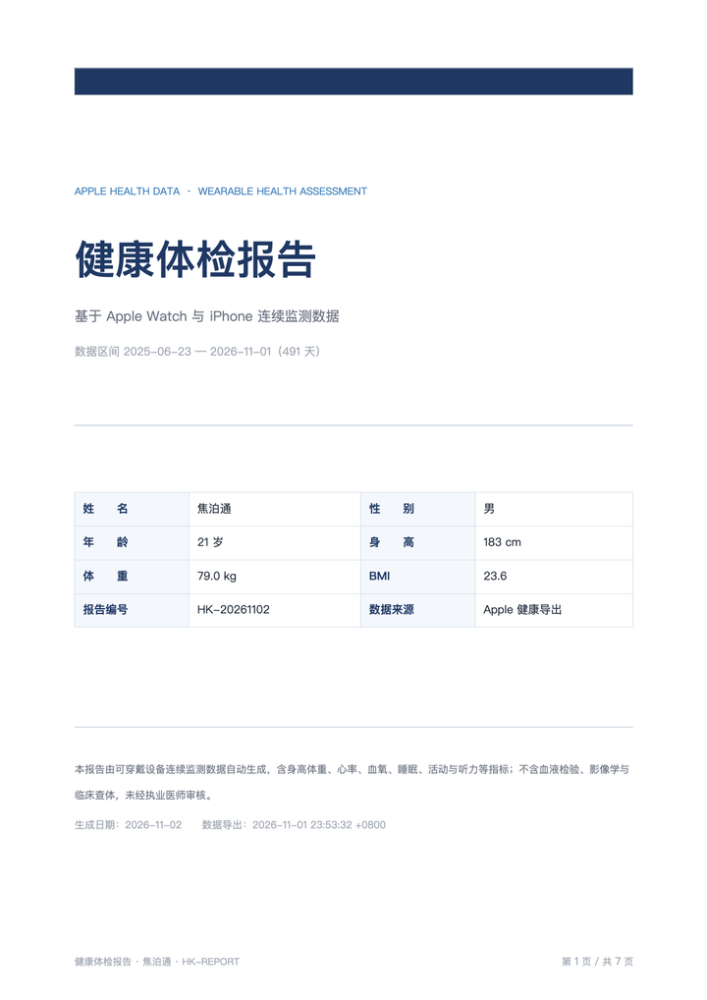
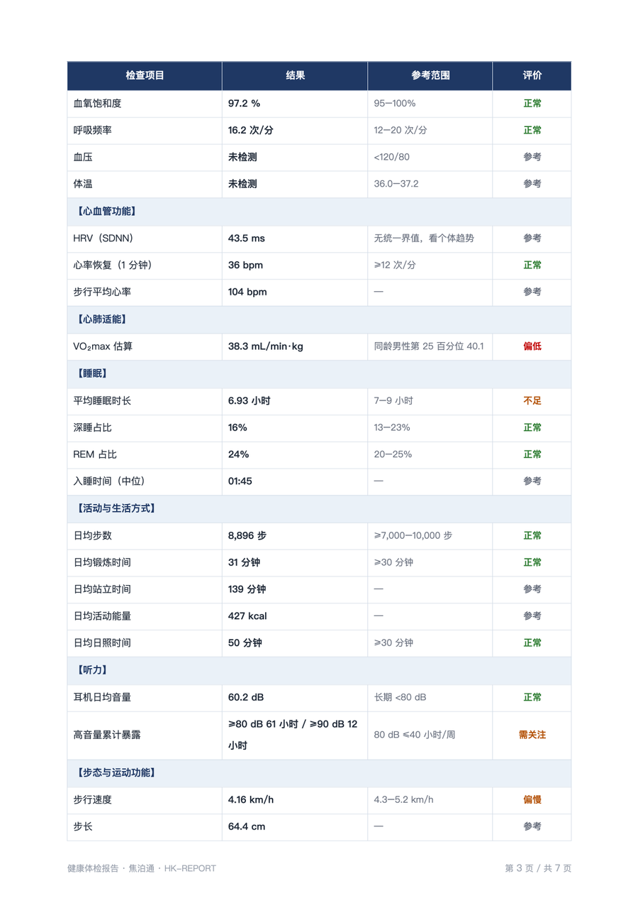

# healthkit-report

> 把 Apple 健康导出变成一份能看的体检报告。

[](https://github.com/your-name/healthkit-report/actions/workflows/ci.yml)
[](https://pypi.org/project/healthkit-report/)
[](https://pypi.org/project/healthkit-report/)
[](LICENSE)

`healthkit-report` 读取 iPhone「健康」App 导出的 `export.xml`，**按设备优先级做时间区间去重**（解决 iPhone 与 Apple Watch 重复计步），计算趋势与参考区间，然后生成三份文件：

| 输出 | 内容 |
|---|---|
| `health-report.docx` | 8 页左右的体检报告：封面、摘要、32 项指标总表、分项解读、异常项与处理建议、健康管理处方 |
| `health-report.xlsx` | 概览 / 每日指标 / 月度汇总 / 训练记录 / 睡眠 / 数据说明 六个工作表 |
| `health-report.html` | 自带 SVG 图表的单文件面板，无 JS、无外部依赖 |

 

## 为什么需要它

Apple 的健康导出是**原始样本**，不是 App 里看到的数字：

- iPhone 和 Apple Watch 会各自记录同一段走路。一天走 8,000 步，导出里可能出现 16,000 步的两倍记录。
- 同一份记录还可能有第三方 App（Keep、小米运动健康等）写入的副本。
- 时间窗不同、单位不同（`Cal`/`kcal`、`km`/`mi`、`min`/`hr`、0–1 与 0–100 的百分比）。

直接求和会得到明显偏高的数字。本项目实现了一套**可解释、可验证**的去重：按时间区间取并集，高优先级设备覆盖的时间段不再重复计入低优先级设备。用「健身记录」三环的每日活动能量做校验，去重后的中位比值是 **1.000**（误差多在 0.1% 内）。

算法细节与边界情况见 [docs/algorithm.md](docs/algorithm.md)。

## 特性

- **流式解析**：787,555 条记录、347 MB 的导出文件，8 秒内解析完成，内存占用与文件大小无关。
- **多设备去重**：时间区间并集 + 设备优先级，优先级可配置（`--priority`）。
- **完整指标**：步数、距离、能量、心率、HRV、静息心率、血氧、呼吸频率、睡眠分期、VO₂max、跑步动态、听力暴露、步态等 30+ 项。
- **三份交付物**：Word 报告、Excel 数据表、HTML 面板，一条命令全出。
- **可改的参考范围**：`healthkit_report/references.py` 里每一条都有出处（中国 BMI 标准、AASM 睡眠推荐、FRIEND 心肺适能、WHO-ITU 安全听音）。
- **零网络**：全部本地处理，不上传任何数据。

## 安装

```bash
pip install healthkit-report          # 基础依赖：python-docx、XlsxWriter
pip install "healthkit-report[fast]"  # 加上 lxml，解析快 5–10 倍
```

Python 3.9+。想从源码开发：

```bash
git clone https://github.com/your-name/healthkit-report.git
cd healthkit-report
pip install -e ".[fast,dev]"
```

## 快速开始

1. iPhone：**健康 → 头像 → 导出所有健康数据**，会得到一个 `apple_health_export.zip`。
2. 解压，拿到 `export.xml`。
3. 一条命令生成全部报告：

```bash
healthkit-report all ~/Downloads/apple_health_export/export.xml -o out --name 张三
```

```
解析 /Users/me/Downloads/apple_health_export/export.xml
  787,555 条记录…
已生成 out/health-report.docx
已生成 out/health-report.xlsx
已生成 out/health-report.html
```

也可以分步执行，便于复用中间结果：

```bash
healthkit-report parse  export.xml -o dataset.json      # 解析 + 去重
healthkit-report analyze dataset.json -o findings.json  # 统计
healthkit-report report  dataset.json -o out --name 张三 # 出报告
```

只想要某一年的数据：

```bash
healthkit-report all export.xml -o out --since 2025-01-01 --until 2025-12-31
```

只出 HTML 面板：

```bash
healthkit-report all export.xml -o out --formats html
```

## 命令参考

| 命令 | 说明 |
|---|---|
| `parse <export>` | 解析 `export.xml` 或解压后的目录，输出 `dataset.json` |
| `analyze <dataset>` | 统计指标、月度、趋势、睡眠、训练、相关性，输出 `findings.json` |
| `report <dataset>` | 生成 DOCX / XLSX / HTML，`--formats` 控制组合 |
| `all <export>` | 以上三步串起来 |

常用参数：

| 参数 | 适用命令 | 说明 |
|---|---|---|
| `-o/--out` | 全部 | 输出文件或目录 |
| `--since/--until` | `parse`、`all` | 日期过滤（含端点） |
| `--priority` | `parse`、`all` | 设备优先级，默认 `Watch iPhone iPad Mac iPod` |
| `--name` | `report`、`all` | 报告上的姓名 |
| `--prefix` | `report`、`all` | 输出文件名前缀（默认 `health-report`） |
| `--formats` | `report`、`all` | `docx,xlsx,html` 的子集 |

## Python API

```python
from healthkit_report import parse_export, analyze
from healthkit_report.render.docx import build_report

dataset = parse_export("export.xml", since="2025-01-01")
findings = analyze(dataset)

print(findings["metrics"]["steps"]["mean"])      # 日均步数
print(findings["sleep"]["mean"])                 # 平均睡眠小时
print(findings["trend_28d"]["resting_hr"]["delta"])  # 最近 28 天静息心率变化

build_report(dataset, findings, "report.docx", name="张三")
```

`dataset` 与 `findings` 都是普通 dict / JSON，可以直接接你自己的分析。

## 输出长什么样

`health-report.docx` 的章节：

1. **报告摘要** — 总体结论、近 3 个月趋势、需重点关注项、未覆盖项目
2. **基本信息与检查条件** — 数据区间、设备、有效监测天数
3. **检查结果总表** — 按「一般情况 / 生命体征 / 心血管 / 心肺适能 / 睡眠 / 活动 / 听力 / 步态」分组，每项含结果、参考范围、评价
4. **分项解读** — 四段通俗解释
5. **异常项汇总与处理建议**
6. **健康管理处方** — 立即 / 1–4 周 / 2–3 个月
7. **本次未覆盖的检查项目** — 血压、血常规、生化、影像等
8. **数据与方法说明 + 免责声明**

## 支持的数据

指标清单、对应的 HealthKit 类型、单位与聚合方式见 [docs/metrics.md](docs/metrics.md)。主要包括：

步数、步行/跑步距离、骑行距离、活动能量、静息能量、爬楼、锻炼时间、站立时间、日照时间、心率、静息心率、步行心率、HRV(SDNN)、心率恢复、呼吸频率、血氧、体重、身高、BMI、VO₂max、手腕温度、步行速度、步长、双支撑、不对称、步行稳定性、环境噪声、耳机音量、跑步速度/功率/步幅/垂直振幅/触地时间，以及睡眠分期。


## 在 DeepSeek Harness 中使用

本项目自带两种 DSH 接入方式，见 [docs/dsh-plugin.md](docs/dsh-plugin.md)：

- **技能（推荐先做）**：把 [`integrations/dsh/skill/SKILL.md`](integrations/dsh/skill/SKILL.md)
  放进 `<项目>/.dsh/skills/healthkit-report/` 或 `~/.dsh/skills/`，DSH 会自动发现，无需重启。
- **插件包**：[`integrations/dsh/plugin/`](integrations/dsh/plugin/) 是一个最小 bundle，
  注册 `healthkit_report` 工具，通过 DSH 的 Plugins 页面安装。
  想分发给别人：[docs/publish.md](docs/publish.md)。

```text
healthkit_report action=all export=/path/to/export.xml out=out
```

## 已知限制

- **设备更换会造成趋势断裂**：没有手表的那段时间没有心率、HRV、睡眠；iPhone 单独计步会系统性偏低。
- **手表指标是估算值**：VO₂max、血氧、手腕温度不能替代临床检验；手腕温度不等于核心体温。
- **睡眠按醒来日期归档**：跨午夜的长睡眠计入醒来当天；午睡会被单独计入。
- **报告文案目前是中文**，英文只需替换 `render/docx.py` 中的字符串。
- 本项目**不是医疗器械**，输出不构成诊断或治疗建议。

## 贡献

欢迎 issue 和 PR：新增指标、翻译、新的报告模板（PDF、Markdown、周报）都很有价值。见 [CONTRIBUTING.md](CONTRIBUTING.md)。

```bash
pip install -e ".[fast,dev]"
python -m unittest discover -s tests -v
ruff check src tests
```

## 发布到 PyPI（维护者）

```bash
python -m build
twine upload dist/*
```

发布前请替换 `pyproject.toml` 中的 `authors`、`Homepage`、`Issues` 以及 README 徽章里的 `your-name`。

## License

[MIT](LICENSE) © healthkit-report contributors
